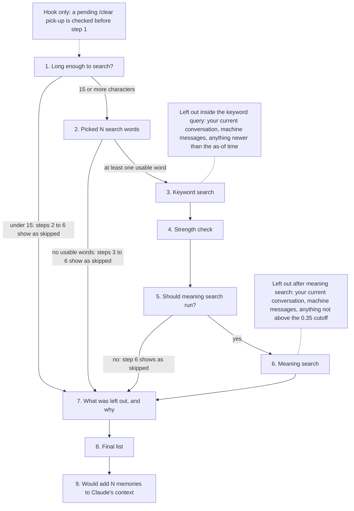
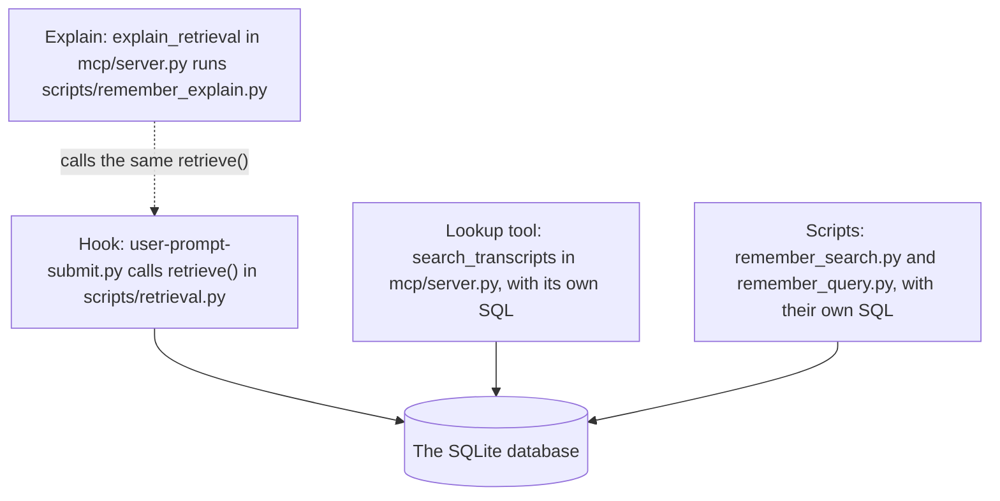
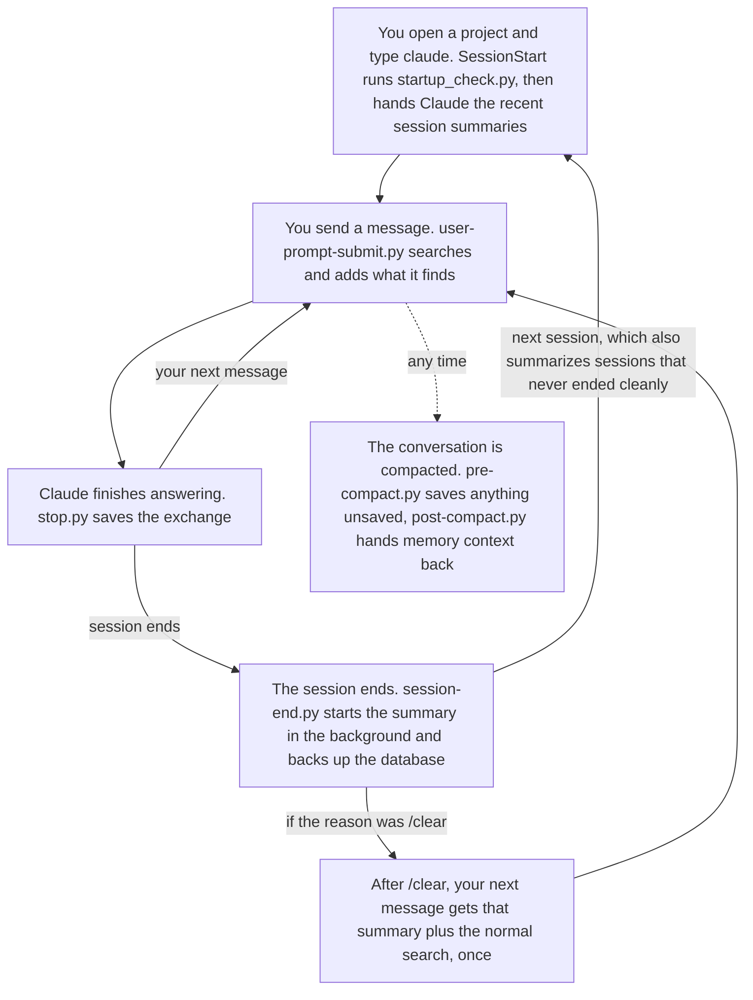

# How this works

- [The short version](#the-short-version)
- [What happens to one message](#what-happens-to-one-message)
- [How per-message search works](#how-per-message-search-works)
- [One question, start to finish](#one-question-start-to-finish)
- [Known limits and corrections](#known-limits-and-corrections)
- [What happens step by step](#what-happens-step-by-step)
- [How to verify it's working](#how-to-verify-its-working)
- [Measuring how well it works](#measuring-how-well-it-works)
- [Why "lessons" are useful](#why-lessons-are-useful)
- [Getting the most out of it](#getting-the-most-out-of-it)
- [The five slash commands](#the-five-slash-commands)
- [If you want to poke around directly](#if-you-want-to-poke-around-directly)
- [Bringing in history from other AI tools](#bringing-in-history-from-other-ai-tools)
- [What this doesn't do](#what-this-doesnt-do)

## The short version

Claude Code forgets everything when a session ends. This project saves every conversation to a database on your own computer. Before Claude reads each message you send, it searches that database and quietly adds the few memories that look relevant.

The search tries your own words first, because that is fast. When the words don't line up, it falls back on meaning. At most 5 memories are added, and anything from the conversation you're already in is never repeated back.

**Look at this first:** type `/remember-explain` followed by a question. It shows every step of the search for that question, with the real numbers, and changes nothing.

<details>
<summary>The three pieces: hooks, a database, an MCP connection</summary>

**Hooks.** Claude Code lets you set up scripts that fire automatically at certain points, like when you start a session, when you send a message, when Claude's done answering, or when a session ends. This project uses six of those. You never actually run them yourself, they just happen in the background.

**A database.** Everything gets dumped into one SQLite file sitting on your disk. Every message, every session, a summary written at the end of each session, and if you set up an API key, a list of "lessons" pulled out of whatever you worked on. It's really just a file, you can pop it open with any SQLite tool if you want to poke around.

**An MCP connection.** This is how Claude asks the database stuff like "what did we decide about X" or "find anything about Y." You don't need to memorize tool names or anything, just talk to Claude normally and it figures out which tools to use.

</details>

## What happens to one message

These are the nine steps `/remember-explain` prints, in its own words. In its headings the `N` stands for a number that changes from run to run. When your question is too short, step 2 reads "Search words: skipped" instead, and when nothing is found, step 9 reads "Would add nothing to Claude's context". The dotted lines are the filters. Step 7 only appears in the explanation, the hook never does it. For what each step does and the code behind it, see [One question, start to finish](#one-question-start-to-finish).



## How per-message search works

Two searches, one merge, and a short list of rules. The tables show the whole picture. The folds hold the full wording.

### Keyword first, meaning-based as the backup

| Mode | When meaning search runs | What it costs |
|---|---|---|
| `on_miss` (the default) | Only when keyword results look unreliable: a weak best match, few of your words matched, or you're asking about the past | The model loads on demand, about 3 seconds and about 600 MB while it is loaded. Nothing runs in the background |
| `always` | On every message, through a small helper that keeps the model loaded | Milliseconds per search. The helper holds memory and quits by itself after `idle_shutdown_min` minutes of nothing (30 by default) |

You choose in `config.yaml` under `semantic_search: mode:`.

<details>
<summary>The full explanation: why keyword first, the four signals, and the helper</summary>

This part does keyword search first since it's quick. Keyword search only matches the words you typed, so it misses a memory that says the same thing in different words. That's what meaning-based search is for: it compares what your message is about instead of its exact words. The catch is cost: the model that does this takes about 3 seconds to load and about 600 MB of memory while it's loaded, so you can pick when it runs with `semantic_search: mode:` in `config.yaml`:

- **`on_miss`** (the default): meaning search runs only when keyword search looks unreliable, and nothing runs in the background. That's judged by four signals. *Score strength:* even the best keyword result is weak, below about one distinctive word's worth of evidence (the bar grows with the size of your memory, so a small database isn't silenced). Without this check, search used to hand back its five least-bad results even when memory had nothing. *Coverage:* the best result contains under a quarter of your keywords (matching 1 of 6 is weak). *Memory phrasing:* you're asking about the past ("what did we decide", "last time", "remember when"), which is exactly when the words rarely match. *Length:* very short messages like "yes" skip retrieval entirely. On real prompts the gate fires on roughly one in four, and those prompts wait a few seconds while the model loads.
- **`always`**: meaning search runs on every prompt, and a small background helper keeps the model loaded so each search takes milliseconds. It starts when your session starts and quits by itself after `idle_shutdown_min` minutes of nothing (30 by default), which frees the memory. It does one thing, turns text into numbers, and never touches your database. It only listens on your own computer and ignores anything that doesn't carry a secret token, which is kept in a file in the `logs` folder (locked to your user on macOS and Linux; Windows doesn't enforce file permissions the same way, so there it relies on the port being local-only plus the token). If it isn't up yet, that prompt just uses keyword search and never waits.

When both searches run, their results are merged and meaning search looks across everything you've saved, not just the current project. `python3 scripts/remember_eval.py` (below) shows which mode finds more on your own history, so you can decide whether `always` is worth its memory.

</details>

### Rules that keep the results useful

| Rule | Why it exists | Evidence |
|---|---|---|
| Never add the conversation you're in | Claude already has it | The `session_filter` in `scripts/retrieval.py:266` |
| Never add machine-written messages | They aren't anything you said | Filter at `scripts/retrieval.py:270`. On the author's history the hook and the tool flag the same 348 of 15,714 messages |
| Favor your project only in a mapped folder | A folder with no mapping isn't a project you chose | Favoring `oth` pushed the right answer out for 3 of 38 questions and helped none (small sample, p = 0.25) |
| When two results match about equally, the newer one wins | So an old answer doesn't outrank a newer one that matches as well | Score divided by (1 + age in days / 365), `scripts/retrieval.py:111`. On the public set, q16 and q17 can only be won this way |
| Search each repeated word once | So repeats don't use up the 8 keyword slots | `scripts/retrieval.py:71` and `scripts/retrieval.py:128` |
| Drop weak matches instead of padding | Search used to hand back its five least-bad results even when memory had nothing | Floor of −2.0 per result (`scripts/retrieval.py:69`) and a bar of 1.05 × ln(messages) for the best one (`scripts/retrieval.py:81`) |
| At most 5 per message | A fixed ceiling on what is added to Claude's context | `scripts/retrieval.py:70`. The cap study found nothing better to ship |
| No typo correction | It found no extra memories, ran about 8 times slower, and turned "kubernetes" into "subagents" | Noted at `scripts/retrieval.py:163` |

<details>
<summary>The rules in full, and why there is no typo correction</summary>

These rules belong to the automatic search the hook runs before every message. Claude's own memory lookup tool shares some of them; the table at the end of this section shows which.

- **Memories from the session you're currently in are never injected back**, since Claude already has that conversation in front of it.
- **Machine-generated messages** (subagent hand-backs, slash-command and `!` shell artifacts) are never returned, because they aren't anything you said.
- **Your project gets a head start, but only in a folder you've mapped.** If the folder matches an entry in `jsonl_project_mapping`, search looks in that project first (up to 3 results), then across everything (up to 7 more), and keeps the best 5; meaning-based matches from that project also get a small boost. A folder that matches no entry favors no project at all. Those folders' messages are filed under the catch-all label `oth`, but that is a filing label, not a project you chose, and when it was measured on the author's history, favoring it pushed the right answer out of the results for 3 of 38 questions and helped none. That is a small sample, not proof: a sign test on 3 vs 0 gives p = 0.25, so luck can't be ruled out. Two things still use `oth` for unmapped folders: the pick-up after `/clear`, and the project name recorded with each message's search event. A folder you deliberately map to `oth` keeps its head start.
- **When two results are about equally relevant, the newer one wins:** a memory's score is divided by (1 + its age in days / 365), so a year-old memory has to match about twice as well as a brand-new one.
- **Repeated words in your message are only searched once**, so they don't use up the 8 keyword slots.

### Why there is no typo correction

There is deliberately no typo correction in the automatic search. An earlier version rewrote words it didn't recognize into the closest real word in your history, which sounds helpful but didn't pay off: on the test set it found no extra memories, made keyword search about 8 times slower, and turned unknown words into unrelated ones ("kubernetes" became "subagents"), so a question about something you never discussed still pulled back confident-looking junk. Searching the words as typed is faster and simply finds nothing when there is nothing, and meaning-based search is what handles wording that doesn't match. (Claude's own lookup tool and the command-line search scripts do fix typos, in different ways; see the table below.)

</details>

### Where search runs, and how the paths differ

The same memory can be searched three ways. They were built for different jobs, so they are deliberately not identical.

| Difference | Hook (automatic) | Lookup tool (Claude, by hand) | Command-line scripts | Why it stays |
|---|---|---|---|---|
| Recency | Newer wins (keyword search only) | None | None | The tool looks up one specific past fact, where an old exact match is often right |
| Typo fix | None | Only when nothing matched | Always, before searching | Claude can judge a "Did you mean" note. The hook injects silently |
| Meaning-search results | 30 candidates, cutoff 0.35, at most 5 | 10 by default (`search_semantic`), no cutoff | Up to 10 or 5 | Claude reads the similarity score. The hook has to pick for Claude |
| Machine-message filter | Hides them (keyword part strips spaces only) | Hides them (strips spaces, tabs and newlines) | None | A message starting with a newline gets past the hook's check: 0 of 348 on the author's history |
| Weak-match gate | Yes, in every mode | None | None | Measured, not shipped |



<details>
<summary>The full table, and the weak-match gate measured for the lookup tool</summary>

The same memory can be searched three ways: the automatic search in the hook, the lookup tool Claude calls by hand (`search_transcripts` in `mcp/server.py`), and the command-line scripts (`remember_search.py`, `remember_query.py`). They were built for different jobs and are deliberately not identical. Each row says what the difference is and why it stays; the "why" is a reason, not a claim about the code.

| Difference | Hook (automatic) | Lookup tool (Claude, by hand) | Command-line scripts | Why it stays |
|---|---|---|---|---|
| Recency | keyword search only: score divided by (1 + age in days / 365). Meaning search has no age term | none | none | The tool is for looking up one specific past fact, where an old exact match is often the right answer. The scripts are developer tools |
| Typo fix | none | only when nothing matched, and only if it changes fewer than half the words (so never on a one- or two-word query) | always, before searching (`remember_search.py`, `remember_query.py`) | Claude sees the "Did you mean" note and can judge it. The hook injects silently, which is why it dropped typo fixing |
| Meaning-search result count | 30 candidates, cutoff 0.35, at most 5 after the merge | 10 by default (`search_semantic`), the caller can change it, no cutoff | `remember_search` up to 10, `remember_query` up to 5 | Claude reads the similarity score shown next to each tool result. The hook has to pick for Claude, so it is strict |
| Machine-message filter | hides them; the keyword part checks the first 80 characters after stripping spaces only | hides them, stripping spaces, tabs and newlines first | none | A message that starts with a newline would get past the hook's check. On the author's history that is 0 of 348 machine messages (the hook and the tool flag the same ones), so changing the hook is left as its own change with its own proof |
| Weak-match gate | if even the best keyword match is weaker than a bar that grows with the size of your memory, all the keyword results are dropped, in every mode. Meaning search then takes over if it is on (in `on_miss` this is one of the reasons it runs); with it off, nothing is injected | none: it returns whatever matched, up to 20 results | none | **Measured, not shipped.** See below |

**The weak-match gate for the lookup tool, measured and not added.** On the author's history, a simulated gate using the hook's own bar:
- cleaned up all 8 of 8 questions that have no answer (today every one of them returns results);
- would have hidden 4 answers that today are found, though deeper than the top 5 (answers in the top 5 stayed at 26 of 38; answers anywhere in the 20 results fell from 37 to 33);
- would have replaced 3 of the 23 real recorded `search_transcripts` calls with "no strong match" instead of 20 results.

The bar is tuned for the hook's search words. The lookup tool picks words differently (it allows digits, up to 10 words, and keeps repeats), so its scores aren't on exactly the same scale, and Claude writes short keyword queries, which may score lower than the full questions this was tested on. The trade was 4 deep answers and 3 real calls for a cleaner "nothing found" answer, and that didn't look worth it. A possible future change, not done here: show Claude each result's match score so it can judge strength for itself instead of having a gate decide. The simulation is `python3 scripts/remember_compare.py mcp-gate --simulate` (via `examples/eval/run_eval.py --compare mcp-gate`).

</details>

## One question, start to finish

This section shows one real run of `/remember-explain`, pasted as it came out, so you can check every step against the code. It shows *what* happens. The *reasons* are already in [What happens step by step](#what-happens-step-by-step) and [How per-message search works](#how-per-message-search-works), so they are not repeated here.

### What was run

Everything below ran on the invented public example in `examples/eval/`, from a mapped folder (project `tdp`), with the time fixed so results don't drift. Each question was run twice and the two outputs matched exactly.

<details>
<summary>How to reproduce it, and what each choice means</summary>

- **The data is invented.** It is the public example in `examples/eval/` (three made-up projects, 54 messages), never real memory. To build it and keep the sandbox: `python3 examples/eval/run_eval.py --keep --out <a folder outside the repo>`. The last line it prints is the sandbox path. (Without `--out` it writes a results folder inside `examples/eval/results/`.)
- **The command**, from the `root` folder inside that sandbox: `echo "<the question>" | CWD=<a folder whose name contains tidepool> python3 scripts/remember_explain.py --as-of 2026-06-01T00:00:00Z`. The fixed `--as-of` time stops the age adjustment from drifting as the calendar moves.
- **The kind of folder: a mapped project.** The sandbox config maps any folder whose path contains `tidepool` to the project `tdp` (`examples/eval/run_eval.py:88`), and the folder I gave contained that name, so search favors `tdp`. From an unmapped folder the Project row reads `none (folder not mapped)`, a note says no project is favored, and the ranking can change. I tried question 1 from an unmapped folder: the same four memories came back, with the last two in the other order. That matches the saved comparison `examples/eval/results/2026-11-24-5505026/compare_project-bias.json`, where question 1 is the only one of the 26 whose results change when the project is not favored. I did not try question 2 there.
- **It is the real code.** `scripts/remember_explain.py` calls `retrieve()` at `scripts/retrieval.py:531`, the same function the hook calls at `hooks/user-prompt-submit.py:380`. Explain writes nothing to the memory database and never sends anything to Claude (if the embedding model fails to load, one error line goes to `logs/semantic_search.log`).
- **No conversation was skipped.** The hook leaves out the session you are in. Here none was given, so the line reads "none given".
- **Each question was run twice**, and the two outputs matched exactly (checked with `cmp`). When meaning search runs, the model prints a one-line notice on stderr. It is not part of the output below.

</details>

### The two questions, and why these two

Both are questions 1 and 10 of `examples/eval/golden_set.yaml`, and both have the same right answer: the session `syn-tdp-04`, which says where the species picker's list comes from. They ask for it in different words.

1. **"where does the species picker get its list of species from?"** uses the answer's own words, so keyword search can answer it.
2. **"how does the app know which sea creatures someone can choose from?"** shares no search word with any stored message (its search words are app, sea, creatures, someone and choose), so keyword search finds nothing and only meaning search can help.

I did not pick the best-looking questions. I tried two other meaning-only questions first (q12 and q13), and they were misses, so they could not show meaning search working. Question 2 is one of the three of the seven meaning-only questions that the default mode finds (see `examples/eval/results/2026-11-24-5505026/eval.txt`).

### Question 1: keyword search answers it

<details>
<summary>The full output, pasted unedited</summary>

```
WHAT HAPPENED
  4 memories would be added, all from keyword search. Keyword search found strong matches (best
  −8.39, needs −4.19 or stronger). Keyword results looked trustworthy, so meaning search was
  skipped.

  Setting                | Value
  -----------------------+--------------------------
  Project                | tdp
  Conversation left out  | none given
  Meaning-search setting | on_miss, from your config
  As of                  | 2026-06-01T00:00:00Z

STEP BY STEP  (the numbered lines alone tell the story)
 1. Long enough to search? Yes: 59 characters, needs at least 15.
 2. Picked 4 search words, set 7 aside.
      kept: species, picker, its, list
      set aside: where, does, the, get, from (too common to help) · of (under 3 letters) · species
          (repeat)
      query sent to FTS5 (SQLite's full-text search): "species" OR "picker" OR "its" OR "list"
 3. Keyword search found 8 possible matches and kept 4.
      Ranked by BM25 score (how strongly the words match; more negative = stronger match), adjusted
        for age (older memories need a stronger match to rank as high):
      # | Memory                           | Project | Date       |  BM25 | Adjusted | Days old | id
      --+----------------------------------+---------+------------+-------+----------+----------+---
      1 | "Where should the list in the    | tdp     | 2025-11-20 | −8.39 |    −5.50 |    192.4 | 41
        | species picker come from?        |         |            |       |          |          |
        | Hardcoding it i…"                |         |            |       |          |          |
      2 | "The species picker now loads a  | tdp     | 2025-11-20 | −5.55 |    −3.63 |    192.4 | 42
        | bundled CSV exported from the    |         |            |       |          |          |
        | regional …"                      |         |            |       |          |          |
      3 | "Offline edit conflicts now use  | tdp     | 2025-09-14 | −3.64 |    −2.13 |    259.4 | 36
        | field-level last-writer-wins:    |         |            |       |          |          |
        | each fiel…"                      |         |            |       |          |          |
      4 | "Sounds good. Everything is      | lgl     | 2026-05-10 | −2.94 |    −2.77 |     21.3 | 18
        | committed, and tomorrow's list   |         |            |       |          |          |
        | is in the no…"                   |         |            |       |          |          |
      (Adjusted = the BM25 score after the age adjustment; it decides the order.)
 4. Strength check: passed, the best match was strong enough.
      best −8.39; the best result must reach −4.19 or stronger (this bar rises as memory grows: 1.05
          × ln(54 messages))
      minimum for any single result (weaker results are dropped one by one): −2.0 or stronger
 5. Should meaning search run? No: keyword results look trustworthy: the best result has 3 of 4
    search words (0.75, needs at least 0.25) and no memory phrasing.
      Mode on_miss (meaning search runs only when keyword results look unreliable). It checks
        coverage (how many of your search words a result contains) and memory phrasing (phrases like
        "what did we decide").
 6. Meaning search: skipped, because keyword results looked trustworthy.
 7. What was left out, and why: 4 in all: 3 duplicates (same project and opening words) · 1 too weak
    for any single result (−2.0 or stronger needed).
      Left out | Reason
      ---------+---------------------------------------------------------
             3 | duplicates (same project and opening words)
             1 | too weak for any single result (−2.0 or stronger needed)
 8. Final list: 4 memories.
      # | Found by       | id | Memory
      --+----------------+----+---------------------------------------------------------------------
      1 | keyword search | 41 | "Where should the list in the species picker come from? Hardcoding
        |                |    | it i…"
      2 | keyword search | 42 | "The species picker now loads a bundled CSV exported from the
        |                |    | regional …"
      3 | keyword search | 36 | "Offline edit conflicts now use field-level last-writer-wins: each
        |                |    | fiel…"
      4 | keyword search | 18 | "Sounds good. Everything is committed, and tomorrow's list is in the
        |                |    | no…"
 9. Would add 4 memories to Claude's context: 741 characters, about 185 tokens (roughly 3/4 of a
    word each: Claude's reading budget).
```

</details>

What to notice: memories 41 and 42 are the right answer, both from `syn-tdp-04`. Memories 36 and 18 are noise that matched on the common words "list" and "its". Keyword search only counts words, so it cannot tell them apart from real answers, and all four would be added.

### Question 2: it needs meaning search

<details>
<summary>The full output, pasted unedited</summary>

```
WHAT HAPPENED
  2 memories would be added, all from meaning search. Keyword search found nothing usable, so
  meaning search ran and found 2 close enough.

  Setting                | Value
  -----------------------+--------------------------
  Project                | tdp
  Conversation left out  | none given
  Meaning-search setting | on_miss, from your config
  As of                  | 2026-06-01T00:00:00Z

STEP BY STEP  (the numbered lines alone tell the story)
 1. Long enough to search? Yes: 66 characters, needs at least 15.
 2. Picked 5 search words, set 7 aside.
      kept: app, sea, creatures, someone, choose
      set aside: how, does, the, know, which, can, from (too common to help)
      query sent to FTS5 (SQLite's full-text search): "app" OR "sea" OR "creatures" OR "someone" OR
          "choose"
 3. Keyword search found 0 possible matches and kept 0.
 4. Strength check: skipped, there were no keyword matches to check.
 5. Should meaning search run? Yes: keyword search found nothing.
      Mode on_miss (meaning search runs only when keyword results look unreliable). It checks
        coverage (how many of your search words a result contains) and memory phrasing (phrases like
        "what did we decide").
 6. Meaning search found 30 candidates and kept 2.
      Ranked by similarity (how close in meaning, 0 to 1; higher = closer). The cutoff (the bar a
        result must clear): above 0.350.
      # | Memory                  | Project | Date       | Similarity | id | Result
      --+-------------------------+---------+------------+------------+----+------------------------
      1 | "Where should the list  | tdp     | 2025-11-20 |      0.408 | 41 | kept
        | in the species picker   |         |            |            |    |
        | come from? Hardcoding   |         |            |            |    |
        | it i…"                  |         |            |            |    |
      2 | "Tide predictions are   | tdp     | 2026-02-12 |      0.370 | 49 | kept
        | now computed on the     |         |            |            |    |
        | device from harmonic    |         |            |            |    |
        | constant…"              |         |            |            |    |
      3 | "The species picker now | tdp     | 2025-11-20 |      0.295 | 42 | left out: below the
        | loads a bundled CSV     |         |            |            |    | cutoff
        | exported from the       |         |            |            |    |
        | regional …"             |         |            |            |    |
      4 | "<task-notification> <t | tdp     | 2026-02-11 |      0.260 | 45 | left out: below the
        | ask-id>bg-7731</task-id |         |            |            |    | cutoff
        | > <status>completed</st |         |            |            |    |
        | at…"                    |         |            |            |    |
      5 | "The tidal-chart screen | tdp     | 2026-02-12 |      0.254 | 48 | left out: below the
        | showed yesterday's      |         |            |            |    | cutoff
        | tides again this        |         |            |            |    |
        | morning, wh…"           |         |            |            |    |
      … and 25 more, all further
 7. What was left out, and why: 28 in all: 28 meaning-search results below the meaning cutoff.
      Left out | Reason
      ---------+------------------------------------------------
            28 | meaning-search results below the meaning cutoff
 8. Final list: 2 memories.
      # | Found by       | id | Memory
      --+----------------+----+---------------------------------------------------------------------
      1 | meaning search | 41 | "Where should the list in the species picker come from? Hardcoding
        |                |    | it i…"
      2 | meaning search | 49 | "Tide predictions are now computed on the device from harmonic
        |                |    | constant…"
 9. Would add 2 memories to Claude's context: 333 characters, about 83 tokens (roughly 3/4 of a word
    each: Claude's reading budget).
```

</details>

What to notice: keyword search found nothing, so step 5 sent it to meaning search. Memory 41 (similarity 0.408) is from the right session. Memory 49 (0.370) is about tide predictions and is unrelated, but it scored just over the 0.350 bar. Memory 42, the actual answer, scored 0.295 and was left out. So this run found the right session, with one unrelated memory beside it. It is not a clean win, and not every meaning-only question works: on the same data, 4 of the 7 are missed (`missed_ids` in the same `eval.json`: q09, q12, q13 and q15). For q13 the right memory scored 0.343, just under the bar.

### The nine steps, and where each one lives

All line numbers are in the code as of this commit.

| # | What happens | Code |
|---|---|---|
| 1 | Counts the characters. Under 15, nothing is searched | `scripts/retrieval.py:72`, `scripts/retrieval.py:580` (the hook has its own check at `hooks/user-prompt-submit.py:344`) |
| 2 | Keeps words of 3 or more letters, drops stop words and repeats, at most 8 | `scripts/retrieval.py:128`, `scripts/retrieval.py:143` |
| 3 | Full-text search: up to 3 from your project, up to 7 from everywhere, drops duplicates and anything weaker than −2.0, keeps 5 | `scripts/retrieval.py:257`, `scripts/retrieval.py:595` |
| 4 | The best result must beat 1.05 × ln(messages), or all keyword results are dropped | `scripts/retrieval.py:247`, `scripts/retrieval.py:604` |
| 5 | In `on_miss` mode, decides whether keyword results look unreliable | `scripts/retrieval.py:352`, `scripts/retrieval.py:657` |
| 6 | The 30 closest by meaning, from all projects. Keeps those above 0.35 | `scripts/retrieval.py:371`, `scripts/retrieval.py:666` |
| 7 | Counts what was left out and why. Explanation only | `scripts/retrieval.py:507`, `scripts/remember_explain.py:475` |
| 8 | Merges the two lists by rank, keeps at most 5 | `scripts/retrieval.py:385`, `scripts/retrieval.py:690` |
| 9 | Builds the "Relevant Memories" text and estimates its tokens. The hook then hands it to Claude | `scripts/retrieval.py:176`, `hooks/user-prompt-submit.py:399` |

<details>
<summary>Each step in words, with every line reference</summary>

All line numbers are in the code as of this commit.

1. **Long enough to search?** It counts the characters in your question. Under 15, nothing is searched and every later step shows as skipped. Both questions passed (59 and 66 characters). The number 15 is `scripts/retrieval.py:72` and the check is `scripts/retrieval.py:580`. The hook has its own check with the number written in, at `hooks/user-prompt-submit.py:344`, which runs before it calls `retrieve()`.

2. **Picked search words.** It lowercases the question and keeps words of 3 or more letters, dropping stop words and repeats, up to 8 words. In question 1 the second "species" is set aside as a repeat, and "its" is kept because it is not on the stop list, which is how it later matched noise. The word rules are `scripts/retrieval.py:128` (`extract_keywords`), the stop list is `scripts/retrieval.py:52`, and the 8-word limit is `scripts/retrieval.py:71`. The reasons shown next to each dropped word come from `scripts/retrieval.py:143` (`keyword_breakdown`). The search text is built at `scripts/retrieval.py:589`.

3. **Keyword search.** SQLite's full-text search looks for any of the words. In a mapped folder it takes up to 3 results from your project and up to 7 from everywhere, removes duplicates and anything weaker than −2.0, and keeps at most 5. Question 1 found 8 possible matches and kept 4. Question 2 found none. See `scripts/retrieval.py:257` (`_keyword_candidates`), the two limits at `scripts/retrieval.py:282` and `scripts/retrieval.py:291`, the weak-result floor at `scripts/retrieval.py:69` and `scripts/retrieval.py:309`, and the cap at `scripts/retrieval.py:314`. It is called at `scripts/retrieval.py:595`.

4. **Strength check.** The best keyword result must beat a bar that grows with the size of memory: 1.05 × ln(54 messages) gives 4.19 here. Question 1's best was −8.39, so it passed. Question 2 had nothing to check. If the best result were too weak, all keyword results would be dropped. The calculation is `scripts/retrieval.py:247` (`_strength_gate`), the 1.05 is `scripts/retrieval.py:81`, and the dropping happens at `scripts/retrieval.py:604`.

5. **Should meaning search run?** In the default `on_miss` mode it runs only when the keyword results look unreliable. Question 1 said no: its best result had 3 of the 4 search words (0.75, and 0.25 is enough) and the question has no "what did we decide" phrasing. Question 2 said yes because keyword search found nothing. See `scripts/retrieval.py:352` (`should_use_semantic`), the 0.25 at `scripts/retrieval.py:98`, the phrasing list at `scripts/retrieval.py:101`, and the call at `scripts/retrieval.py:657`. In `always` mode this step is not asked: see `scripts/retrieval.py:640`.

6. **Meaning search.** It compares the question's meaning with the stored messages, takes the 30 closest from all projects, and keeps those above 0.35. Question 1 skipped it. Question 2 got 30 candidates and kept 2. See `scripts/retrieval.py:371` (`semantic_rows`), the cutoff at `scripts/retrieval.py:88`, the 30 at `scripts/retrieval.py:89`, and the calls at `scripts/retrieval.py:666` and `scripts/retrieval.py:678`.

7. **What was left out, and why.** This step exists only in the explanation. The hook never does it. It counts what was set aside along the way: duplicates, results under the floor, results the strength check dropped, and meaning results under the cutoff. In question 1, 4 were left out: 3 as duplicates (same project and same opening words, which is what happens when the project search and the all-projects search find the same memories) and 1 as too weak. The counting uses `retrieve(detail=True)`, with `scripts/retrieval.py:507` (`count_filtered`), and the wording is at `scripts/remember_explain.py:475`.

8. **Final list.** The keyword and meaning lists are merged by rank, so a memory both found moves up, duplicates are removed, and at most 5 stay. Question 1 had only keyword results and Question 2 only meaning results, so no memory was found by both. See `scripts/retrieval.py:385` (`merge_results`), the cap at `scripts/retrieval.py:403`, and the call at `scripts/retrieval.py:690`.

9. **Would add to Claude's context.** The final memories become a short "Relevant Memories" text block: the date, project and the first 400 characters of each. The token count is the characters divided by 4 (`scripts/retrieval.py:718`), which is an estimate. The block is built at `scripts/retrieval.py:176` (`format_memories`) and `scripts/retrieval.py:710`. The hook then hands it to Claude at `hooks/user-prompt-submit.py:399`. Explain stops before that point.

</details>

### The path as a picture

The diagram is at the top of this page, under [What happens to one message](#what-happens-to-one-message), so it isn't repeated here.

Question 1 took the path 1, 2, 3, 4, 5 (no), 7, 8, 9. Question 2 took 1, 2, 3, 4 (nothing to check), 5 (yes), 6, 7, 8, 9.

Not shown here: the `always` mode, the `/clear` pick-up, and a keyword result that fails the strength check. Each of those changes the middle of the path, and `retrieve()` at `scripts/retrieval.py:531` handles them.

## Vector search vs a regular database

<!-- Reserved. To be written. -->

## Known limits and corrections

| Limit or correction | In plain words |
|---|---|
| The self-test and the hook searched differently | The self-test asks with no project. From commit `c26a868` until the Phase 4 change the hook always had one, so the self-test was about 8 points too optimistic on the author's history: 32 of 38 answerable questions found with no project, 29 asked the way the hook searched. Unmapped folders now search with no project (commit `5505026`), so they match the self-test. A mapped folder still favors its project, which only the public example measures |
| Three questions are a small sample | The 32 versus 29 gap is 3 questions against 0. A sign test gives p = 0.25, so luck can't be ruled out |
| The cap of 5 | The study's rule found the same 29 of 38 as the cap of 5, within noise. Bigger limits found 3 to 5 more answers at about 1.2 to 1.9 times the tokens. Nothing shipped |
| The lookup tool has no weak-match gate | A simulated gate cleaned up 8 of 8 questions with no answer but would have hidden 4 answers that are found today. Not shipped |
| The fixed time only reaches keyword search | The self-test's `as_of` applies to keyword search. Meaning search ignores it |
| The machine-message check is not identical everywhere | 60 characters in Python, 80 in the hook's SQL, and the hook strips spaces only, so a message that starts with a newline gets past it |
| Folder-to-project matching has quirks | It is a substring test, and three rules can disagree when one entry's name contains another's. Documented, not changed |
| Meaning search does not hide machine messages | `search_semantic` does not leave out harness-written messages the way keyword search does. About 12% of embedded messages on the author's history are machine-written |
| The MCP server is not strictly read-only | When a search finds nothing, its typo-correction step can create a small word-list table (`transcripts_fts_vocab`) in the database. The eval and `/remember-explain` avoid this; the live server does not |
| A running MCP server keeps old code | It loads the code once, so after an update it keeps running the old version until it is restarted |
| Telemetry labels were not bumped | The `mode` labels (such as `on_miss_v3`) did not change when `same_project_n` changed meaning (0 now means no project was favored). The "From the current project" share drops in unmapped folders because of the new definition, not because retrieval got worse. Compare by date only |
| A `/clear` is looked up by project, not folder | One unmapped folder's pending `/clear` (stored under `oth`) can show up in another unmapped folder (none pending at the time of writing), and two hooks firing at once can both show the same one |
| What the system can't do | It can't see tool output, it is single user and single machine, and the first meaning search in a session needs a few seconds to warm up. See [What this doesn't do](#what-this-doesnt-do) |

<details>
<summary>The correction about what the self-test measured, in full</summary>

**A correction about what this test measured.** The self-test asks every question with no current project. From commit `c26a868` until the Phase 4 change, the live hook always had one, because a folder with no mapping was treated as `oth`. On the author's history that made the self-test about 8 points too optimistic: asked with no project it found 32 of 38 answerable questions, and asked the way the hook really searched it found 29 (three questions, a small sample: p = 0.25, not proof). Unmapped folders now search with no project again (commit `5505026`), so the self-test matches them. In a mapped project folder the hook still favors that project, which the self-test does not measure. The 32 and 29 come from the paired comparison (`examples/eval/run_eval.py --compare project-bias`), not from memory notes. On the public example, where every question is asked from its own mapped project, favoring the project changed which memories came back for 1 of 26 questions and the number found for none.

</details>

<details>
<summary>Known quirks in how folders and projects are matched, in full</summary>

**Known quirks in how folders and projects are matched** (documented, not changed, because each fix would change which project messages are filed under):
- Three rules turn a folder into a project: the hook takes the first `jsonl_project_mapping` entry, in file order, whose name appears in the folder path; live capture tries the longest name first, on the transcript file's path before the folder; and the importer goes in file order, file path first, then the folder recorded in the transcript. They agree for ordinary names and can disagree when one entry's name contains another's.
- The match is a substring test, so an entry named `other` also matches "another" or "brother". On the author's history no stored `oth` message was affected.
- On the author's snapshot, 656 of 12,587 `oth` messages (5.2%) still carry the label `oth` even though all three rules would now file their folder under a named project. Most likely the mapping was edited after they were stored; that wasn't checked. Their labels were not changed, so they turn up in searches for `oth`, not for their project. Of the `oth` messages, 94.8% come from folders that match no entry at all.
- `remember_baseline.py` replays stored `oth` messages with their stored label, so it still favors `oth` for them. Stored messages can't tell a deliberately mapped `other` folder from an unmapped one.
- `same_project_n` in `retrieval_events` is 0 for messages sent from an unmapped folder, because no project is favored there.
- The machine-message check is 60 characters in Python (`is_machine_generated`, used by the metrics layer and eval) and 80 in the hook's SQL. It only matters at the edges; on the author's history all three definitions flag the same 348 of 15,714 messages.
- The fixed time the self-test uses (`as_of`) applies to keyword search only. Meaning search ignores it, so a run at a fixed time could still see newer messages through meaning search. The cap study checked that this can't change the numbers reported here.

</details>

## What happens step by step



The six hooks fire at these moments. You never run them yourself. Each moment is written out in the fold.

<details>
<summary>Each moment in words</summary>

### When you open a project and type `claude`

The session start hook checks if there are any new chat logs it hasn't seen, pulls them in, backs up the database, and gives Claude a quick summary of what happened last time plus anything that got left unfinished.

### Every time you send a message

A hook digs through the database for anything relevant to what you just typed and quietly tosses it into Claude's context before Claude even sees your message.

And this happens on literally every message, not just right after you run `/clear`. The `/clear` recovery thing below is really just for one specific moment, the message right after you clear mid session. Most of the time when you're bringing up old stuff it has nothing to do with `/clear` at all, like you close your terminal on Monday, open a new one Wednesday, and ask "what did we decide about the database schema" and that's a totally new session that never went near `/clear`. If search only ran right after clearing, that Wednesday question would just come back empty since nothing was ever cleared. This per message search is the whole point of the project, remembering stuff across sessions, not just across a single `/clear`. The `/clear` recovery thing is just a smaller bonus feature on top of that.

*How it decides what to inject is covered in [How per-message search works](#how-per-message-search-works).*

*To watch it handle one real question, step by step, with the code lines for each step, see [One question, start to finish](#one-question-start-to-finish).*

### Every time Claude finishes answering

The whole exchange gets saved to the database right away. It doesn't wait till the session ends. So if your terminal crashes you don't lose the conversation, just the end of session summary.

### When a session ends

When a session ends, meaning you ran `/exit`, closed the terminal, or hit `/clear`, there's a background script that reads through the whole conversation and asks Claude Haiku to write an actual summary, what you were doing, what got decided, what's still unfinished, what to pick up next time.

If that call fails for whatever reason (no API key, no internet, hit a rate limit) it falls back to a simpler note instead, putting together just the project name, how many messages were in the session, the time range, and a tiny preview of your first message. That fallback note isn't nearly as useful as a real generated summary, but at least it's clearly marked as a fallback and the session still ends up in the database with something attached to it. The alternative would be writing nothing at all, which means that session disappears from your history since nothing ever points back to it. Either way something gets written, just a question of how useful it ends up being.

### When a session doesn't end cleanly

What if the session doesn't end cleanly at all -- if you just close the terminal tab, force-quit, or your machine sleeps or crashes mid-conversation, none of that gives Claude Code a chance to fire the end-of-session hook. This means that the session would just sit there forever with no summary and no notes permanently. The fix for this doesn't try to catch the crash itself (nothing can run code after the process is already gone) -- so instead, every time you start a **new** session anywhere, it checks for any *other* session that's still missing a summary and whose last message is more than 30 minutes old, and runs the normal summarization pass on it then, tagged so you can tell it was caught late rather than a real `/exit`/`/clear`. It only does at most 5 of these per startup so it can't slow down the session you're trying to start. Once a session gets picked up this way it's marked as handled, so it won't get re-swept by a later startup too. If you come back to a chat you'd only paused (not force-quit) and it got summarized while you were out for over half an hour, that's expected and harmless -- the provisional summary just gets fully overwritten with the real one whenever you do end that session for real. The "lessons" pulled out of that session (see below) aren't affected by this either -- before writing any lesson, it checks what's already been recorded for that same session and skips anything already there, so even though the summarization step can potentially run twice on the same conversation, nothing gets duplicated in your lessons.

### When you run `/clear`

In the old version, running this command only tried to bring back context if you came back within five minutes, and even then it just dumped the last 10 exchanges (20 messages) at you. Now there's no time limit at all, so whenever you come back, even days later, your next message gets the real summary from before mixed with a normal keyword search based on whatever you just typed. It only does this once per `/clear` though, so it won't keep repeating itself on every message after.

### When Claude Code compacts the conversation

Compaction, whether you run `/compact` or it happens automatically, shrinks what Claude is holding in its context. Just before it, `hooks/pre-compact.py` saves any messages that haven't been saved yet, so the shrink loses nothing. Just after it, `hooks/post-compact.py` hands Claude the recent session notes and the project summary again, so it has memory straight away instead of starting blank.

</details>

## How to verify it's working

Everything runs silently, so check the logs. They are all under `logs/` (gitignored, local only). Run `tail -20 <file>` from the project root to see the end of one.

| Log | What a line means | Healthy looks like |
|---|---|---|
| `retrieval.log` | One line per message saying what search did (`keyword_hit`, `semantic_hit`, `hybrid_hit`, `weak_keyword`, `no_match` and a few more) | A hit when you ask about something you know is in your history |
| `summarize_session.log` | Written when a session ends. `WARN` is a retry, `ERROR` means the note fell back to a plain placeholder | Mostly empty |
| `hooks.log` | A hook failed to launch, or its context build threw | Empty or missing |
| `semantic_search.log` | Meaning search is broken (the model failed to load, or a corrupted row) | Empty |

One command for all of them: `tail -n 10 logs/*.log logs/*/*.log 2>/dev/null`. For the bigger picture (database integrity, backup freshness, embedding coverage), run `python3 scripts/remember_health.py`, the 9-point dashboard.

<details>
<summary>The same list with every detail</summary>

Everything above happens silently in the background, which is the point, but it also means you have no idea whether any of it is working unless you check. A handful of log files under `logs/` (gitignored, local only) exist specifically so you can check instead of guess. None of this needs a conversation, just run these from the project root.

- **`tail -20 logs/retrieval.log`** -- one line for most messages you send, recording what the per-message search did: `keyword_hit` (fast path worked), `weak_keyword` (even the best keyword result was weak, so it tries meaning-based search), `semantic_hit` (keyword search came up empty or weak and meaning-based search found something), `hybrid_hit` (keyword and meaning search both contributed), `no_match` (both struck out), `no_match_semantic_unavailable`, `skipped_no_keywords` (the message was only stop words, so there was nothing to search for), or `retrieval_unavailable` (the search code failed to load, so the hook did nothing; nothing else reports this, so this log is where you'll see it). Two things to know when reading it: messages under 15 characters, and the first message after `/clear` (which gets the recovery summary instead), write no line at all; and some messages write two lines (`weak_keyword` then `semantic_hit`, or `keyword_hit` then `hybrid_hit`). Each line also shows the keywords it searched for and a snippet of what you typed. What to look for: ask about something you know is in your history, then check this log -- if you got a real answer, you should see `keyword_hit`, `hybrid_hit` or `semantic_hit`. If you see `no_match` for something that should be findable, that tells you the search genuinely didn't find it (wrong keywords extracted, content phrased differently than you searched, etc.), not that something silently broke.
- **`tail -20 logs/summarize_session.log`** -- written once when a session ends (`/clear`, `/exit`, closing the terminal). Healthy: this file stays mostly empty, since a successful summary doesn't log anything. A `WARN` line means Haiku's first attempt didn't follow the required summary format and it retried once. An `ERROR` line means both attempts failed (or something else threw, like a missing API key or a network error) and that session's notes fell back to the plain placeholder instead of a real summary. If you see an `ERROR`, you can confirm which session it hit and check what got saved: `sqlite3 claude_remembers.db "SELECT notes FROM sys_sessions WHERE session_id='<id from the log line>'"` -- a real fallback note starts with `AUTO-GENERATED FALLBACK`.
- **`tail -20 logs/hooks.log`** -- should be empty, or not exist at all, under normal operation. Anything in here means one of the hooks that launches a background script (capturing your messages, running the startup ingest/backup, rebuilding context after compaction) either failed to launch at all, or the whole context-build step inside `session-start.py`/`post-compact.py` threw and silently returned nothing to Claude instead of crashing visibly. This is the first place to check if memory suddenly "feels broken" -- missing context, no session-start checklist, that kind of thing.
- **`tail -20 logs/semantic_search.log`** -- should also be empty. A line here means the meaning-based fallback search is broken (the embedding model failed to load, or a corrupted row in the database couldn't be read) -- which matters because when this is silently broken, you're only ever getting keyword search's results and have no way to tell the difference from "nothing in semantic search matched."
- **Check everything in one shot:** `tail -n 10 logs/*.log logs/*/*.log 2>/dev/null` dumps the tail of every log at once. For the bigger picture beyond logs -- database integrity, backup freshness, embedding coverage -- `python3 scripts/remember_health.py` is the 9-point dashboard these logs feed into.

</details>

## Measuring how well it works

The logs say whether something broke, not whether the results are good, so there is a measurement layer on top. It is on by default, stores only ids, names, lengths and counts (never your prompt text), and `metrics: enabled: false` turns it off.

| What | How you get it | What it tells you |
|---|---|---|
| Raw numbers | Tables `retrieval_events`, `tool_events`, `api_usage` | What search did, which tools Claude used, the real token counts |
| A "before" picture | `python3 scripts/remember_baseline.py` | Replays your real past prompts through today's search code. Save one before a change, run it again after |
| Right now | `python3 scripts/remember_metrics.py` | How often memory was injected, how old and well matched, how fast, what it cost |
| Is search right for you? | The Memory Check, `python3 scripts/remember_check.py`, which runs by itself every couple of weeks | Whether search finds the right memories, in a sentence or two |
| The self-test | `python3 scripts/remember_eval.py` | Asks every question six ways and checks whether the right session comes back |
| A public rerun | `python3 examples/eval/run_eval.py` | The same test on invented data anyone can check |
| Is a cap of 5 right? | `scripts/remember_cap_study.py` | Replays 17 policies. Nothing shipped |

<details>
<summary>Everything in this section, in full</summary>

The logs above tell you whether something broke. They can't tell you whether the memory is *good* -- `keyword_hit` only means the search returned something, not that it returned the right thing. So there's a small measurement layer on top. It's on by default, stores only ids, names, lengths and counts (never your prompt text or shell commands), and `metrics: enabled: false` in `config.yaml` turns it off without affecting memory itself.

### What gets recorded

Three tables in the database hold the raw numbers:

| Table | What it holds |
|---|---|
| `retrieval_events` | one row per prompt the hook handled: which path fired, how long it took, which memories it injected (by id), how old they were, how well they matched your words, and how many tokens that cost. Every prompt gets a row, including the ones that were skipped, so injection rate is measurable. |
| `tool_events` | one row per tool call Claude made: the tool name, the file it touched (or just the program name for shell commands), whether it worked, and how big the result was. This is what shows how often Claude searched memory by hand. |
| `api_usage` | one row per API response with the token counts the API itself reported (fresh input, cache reads and writes, output). This is where the real token numbers come from. |

### Scripts that report on it

- **`python3 scripts/remember_baseline.py`** -- a plain-language "before" picture. It replays your real past prompts through the current search code (against a throwaway snapshot copy, never your live database), as the memory stood when you typed each one, and reports how often it found something, how old and how well-matched the results were, and what that cost. Save one before changing how retrieval works, run it again afterwards, and the difference is the effect of the change. `--limit 500` for just the recent prompts, `--label name` to name the saved result, `--json` for raw numbers.
- **`python3 scripts/backfill_metrics.py`** -- fills `tool_events` and `api_usage` from history captured before this layer existed. Run it once (`--dry-run` first if you like); it's safe to re-run and only ever adds rows. New activity is recorded automatically.
- **`python3 scripts/remember_metrics.py`** -- what retrieval is doing right now: how often memory was injected, how old and well-matched it was, speed, the measured token cost (including the cost of injected text being re-read on later replies), and pipeline health. `--days 30`, `--project name`, `--markdown` for a table. It reports cost and quality, not "tokens saved", because savings can't be observed directly.

One thing to know about reading the baseline: the "meaning-based search would have kicked in" number is a *count*, not a test. Loading the model for thousands of replays wouldn't tell you anything about live behavior, so the replay only reports how often it would have happened: both how often the fast path came up empty, and how often `on_miss` would have loaded the model.

### The Memory Check (runs by itself)

**The Memory Check** (`python3 scripts/remember_check.py`) -- the part you never have to think about. Every couple of weeks, once there's enough history, it quietly runs in the background and answers one question: *is search finding the right memories for you?* It looks at the decisions recorded in your own past sessions, turns a sample of them into the kind of question you might ask weeks later ("where did we move the API key?"), asks search those questions, and checks whether the right conversation came back. It also asks a few questions about things you never discussed, to make sure search stays quiet when it has nothing. The result is mentioned once at the start of a later session, in a sentence or two of plain words, and tells you whether your `semantic_search` mode is a good fit or whether switching would help. You don't write questions, review anything, or remember to run it. You can read the full report any time with the command above, or run a fresh check with `--now`. To turn it off, set `memory_check: enabled: false` in `config.yaml`.

**How the questions are kept fair, since nobody reviews them.** A decision is only used if its own session really contains the answer (checked by meaning against that session's messages), so a miss means search failed, not that the question was unfair; in practice a few decisions in every history fail this, usually settings that were changed without being discussed, and they're left out. If two sessions recorded the same decision, either one counts as correct. Each decision is asked two ways, because one unlucky wording can move a score by several points. The wording comes from one small Claude Haiku call (the same API key your session summaries already use), told to keep the distinctive terms a person would still remember but phrase the rest naturally. If that call can't be made, the check falls back to simple templates that reuse the notes' own words, which are too easy to judge anything by, so in that case the report says so instead of giving a verdict.

**How far to trust it.** On this project's history the automatic check landed within roughly 5 to 10 points of a hand-checked set, and agreed on which way was better in every run, but a single run still moves by about 5 points depending on how the questions happen to be worded. Trust the comparison between modes more than any one percentage. It needs about a dozen past sessions with recorded decisions before it says anything.

### The self-test (`remember_eval.py`)

**`python3 scripts/remember_eval.py`** -- the memory's self-test. The other scripts show what the system *did*; this one checks whether it did the *right thing*. Nothing needs to be set up or run for your memory to keep working. This is just a way to find out how good it is.

**The idea.** Take a question you know the answer to, like "where does the species picker get its list of species from?" and the past session where that answer lives. Ask the search the question, and see whether that session comes back. Do that for a few dozen questions and you have a score. Mix in a few questions that have no answer anywhere in memory, and you also learn something just as important: whether search stays quiet when it should, or hands back junk anyway.

**It asks every question six ways**, so you can see what each piece contributes:
- *Keyword search only.*
- *Keyword search without the weak-match gate*: the same search with the gate turned off, so you can see exactly what the gate is worth.
- *Meaning-based search only.*
- *`on_miss`*: keyword search, plus meaning search only when the gate says keyword search can't be trusted. This is the default mode.
- *`always`*: keyword and meaning search together on every prompt.
- *The MCP lookup tool (`search_transcripts`)*: what Claude gets when it searches memory by hand mid-conversation. It is a separate search from the automatic one above (no gate, no recency weighting, up to 20 results; it hides machine-written messages like the hook does), so it gets its own score.

**Reading the report.** For each way you get three plain numbers: how often the right memory was among the top 5 results, how often it was ranked first, and how often it injected junk when there was no answer. Higher is better for the first two, lower for the junk rate. It also counts how often a machine-generated message (a subagent hand-back, command output) came back, which should be never.

**A public version anyone can rerun.** Your own questions can't be shared, so `examples/eval/` holds a small invented dataset (three made-up projects, 54 messages) and 26 questions. `python3 examples/eval/run_eval.py` builds it into a throwaway database with the real code and scores it, without touching your config or memory. See `examples/eval/README.md`.

**A correction about what this test measured.** The full wording moved to [Known limits and corrections](#known-limits-and-corrections).

**What it's good for.** Deciding things with evidence instead of guesses. The weak-match gate's threshold was set by this test, and so was the decision to drop typo correction. Run it before and after any change to search (`--label name` saves each run) and the difference is the effect of the change. A question counts as found if *any* message from the right session comes back, not one exact message.

**Where the questions live.** Questions come from your own history, so they stay on your machine: `eval/golden_set.yaml`, which is gitignored. Each entry is a question plus the session ids that hold the answer (any of them counts). Sessions that quote the questions themselves go under `exclude_sessions` so the test can't cheat by finding its own question. `--golden path` points it at a different file.

### Is a fixed cap of 5 right? (the cap study)

The hook injects at most 5 memories. `scripts/remember_cap_study.py` asked whether that number, or a rule that depends on how good each match is, would do better. It replayed 17 policies over the same candidate memories on the author's history (38 answerable questions, 8 with no answer): fixed caps of 1, 2, 3, 5, 10 and 15; score-margin and largest-gap rules; no cap; and token budgets of 250, 500 and 1000. Nothing was shipped:
- The rule the study picked (score margin, ceiling 5) found the same 29 of 38 as today's cap of 5, with a little less junk (2.66 junk rows per question vs 3.13) and about 10% fewer tokens (316 vs 349 on average). With 38 questions that is within noise.
- Bigger limits found 3 to 5 more answers (32 to 34 of 38) at about 1.2 to 1.9 times the tokens (no cap at all: 34, at 2.4 times). The keyword search only fetches 3 project rows and 7 other rows, which limits the candidates on 45 of 46 questions, so those gains are lower bounds, and bigger limits weren't measured.
- Shipping anything other than 5 would need a separate injection limit, because the weak-match gate and the meaning-search gate currently look at the same top 5.

</details>

## Why "lessons" are useful

A lesson is a standalone fact pulled out of a session so it outlives that one conversation. It only works from what gets said in text, not from what gets run.

<details>
<summary>The full explanation</summary>

A session summary is tied to one conversation. A lesson is different, it's more like a standalone fact that's supposed to outlive that one session. Like if you spend an hour figuring out some approach causes a bug, that's worth remembering next time you're anywhere near that problem, not just buried somewhere in one session's notes. The summarization step pulls these out automatically whenever there's something that seems worth keeping.

The catch here is it only works off what gets said, not what gets run. Claude Code doesn't save the actual output of tool calls, so stuff like code execution results, notebook cell outputs, whatever a command printed, none of that goes into this memory system. Only the plain text of your messages and Claude's replies gets captured. So if Claude runs something and sees a cool result, that result only makes it into memory if Claude types it out in the reply. There's a standing instruction in the global Claude Code config telling Claude to do exactly that, say real findings out loud instead of just quietly moving on, because otherwise a real result can happen and just never get remembered.

</details>

## Getting the most out of it

Set up the API key, add your real projects, run `python3 scripts/batch_embed.py` once in a while, and just talk normally.

<details>
<summary>Why each one helps</summary>

- **Set up the API key.** Without it the session summaries are pretty plain and mechanical. With it they're more useful, providing real reasoning about what happened instead of just a message count.
- **Add your real projects.** Run `/remember-add-project` for each one (see below).
- **Running `python3 scripts/batch_embed.py` every once in a while is still worth it.** New messages, including imported ones, get embedded automatically as they come in now. This script is just a catch up pass for anything that slipped through, like if semantic search was turned off in `config.yaml` during an import and you've since turned it back on. It's pretty quick, like a few seconds for thousands of messages.
- **Just talk normally.** You don't need slash commands or any special phrasing. Just ask "what did we decide about the database schema" the same way you'd ask a person.

</details>

## The five slash commands

| Command | What it does |
|---|---|
| `/remember-add-project` | Registers a project folder |
| `/remember-import` | Brings in a Claude.ai, ChatGPT or Gemini export. You pick the folder |
| `/remember-status` | Session and message counts, a per-project breakdown, last backup time, embedding coverage |
| `/remember-explain` | Shows every step of search for one question, with the real numbers |
| `/remember-questionnaire` | Helps you fill in `remember-questionnaire.txt` and imports your answers |

<details>
<summary>What each one does and why it is useful</summary>

These are the only commands you type yourself day to day - everything else (capture, search, context injection) runs automatically through the hooks and MCP connection without you asking.

### `/remember-import`

What it does: walks you through importing conversation history from a Claude.ai, ChatGPT, or Gemini export - lists files found in `imports/`, shows you the title/about/tags for the one you pick, asks which project folder it belongs in, then imports it. Why it's useful: any history from before this project existed, or from a different platform, would otherwise just sit outside the database forever - this is the one-time bridge that gets it into the same searchable store as everything captured automatically going forward.

### `/remember-status`

What it does: runs `scripts/status.py` and shows you session/message counts, a per-project breakdown, last backup time, and semantic search embedding coverage. Why it's useful: everything else in this system happens silently in the background, so there's normally no feedback at all that it's working - this is the fastest way to confirm data is being captured and growing, without reading a log file or starting a real conversation.

### `/remember-explain`

What it does: takes one question and shows every step memory retrieval takes for it, with the real numbers: which words were searched, how strongly each result matched and what it was compared against, whether meaning search ran and why, what was left out, and what would be added to Claude's context. Why it's useful: retrieval otherwise happens silently before every message, so this is the only way to see why a memory did or didn't come back. Claude can also run the same explanation itself through the `explain_retrieval` tool when you ask "explain how you found that". When it isn't told which conversation to leave out, it leaves out the newest session file for the folder, which can be the wrong one if two conversations are open in the same folder; pass `--session` (or `exclude_session` to the tool) to be exact. It runs `scripts/retrieval.py`'s `retrieve()`, the same function the hook uses, on a read-only connection, so it writes nothing to the memory database: no event row, no change to what counts as shown after a `/clear`, and no `retrieval.log` line. The one exception is that if the embedding model fails to load, one error line goes to `logs/semantic_search.log`. It does not start the background helper; in `always` mode it only asks one that is already running. To install the command without rerunning the whole setup: `.venv/bin/python scripts/remember-setup.py --commands-only` (writes only missing command files).

### `/remember-questionnaire`

What it does: helps you fill out `remember-questionnaire.txt` (identity, family, professional background, working style, goals, etc.) and imports your answers into `remember_facts`. Why it's useful: these facts load into every session regardless of folder by default, and they capture things that may never come up naturally in a technical conversation (communication preferences, pet peeves in AI responses, decision-making style), which passive accrual from chat history would likely never surface on its own. It's also the only thing that feeds the `get_profile` MCP tool - `remember_facts`/`remember_preferences` are written to in exactly one place in this whole codebase (`remember-setup.py`, via its quick setup questions or this questionnaire import), nothing else ever inserts into them during normal conversation. Every project's `CLAUDE.md` tells Claude to call `get_profile` for "my preferences"/"my profile" questions, and without running this at least once, that call hits `get_profile`'s own hardcoded fallback - `"Profile is empty. No remember_facts or remember_preferences populated yet."` - a dead end built into the tool itself, not just a gap you happen to leave unfilled.

**Project-scoped preferences.** you can set preferences for just one project. Use a header like `## PROJECT:<prefix> CATEGORY`, or simply ask Claude to assign that section to a specific project. Project-specific settings automatically override your global defaults whenever you work in that project folder.

**How to check it worked**
- **Query the database directly** - the fastest, most certain check:
  ```bash
  sqlite3 claude_remembers.db "SELECT category, key, value, project FROM remember_facts WHERE project='<prefix>'"
  ```
  A row with your answer and the right `project` value means the import worked.
- **Ask Claude Code itself, in a fresh session started in that project's folder** - e.g. "what's my working-style preference for this project?" Because this profile is force-injected silently into context (not printed back as a visible heading - only things like the Session Start Checklist get echoed, since only those come with an explicit "print this" instruction), Claude should answer immediately from context with no tool call. If it has to go search or call a tool to answer instead, that's a sign the injection didn't fire for that session.

### `/remember-add-project`

What it does: registers a new project in one non-interactive pass given a folder path - derives a name/prefix/label from it and creates the folder's `CLAUDE.md`, config entry, database row, and MCP registration, no prompts. Why it's useful: without a registered project, everything you work on falls into the generic catch-all bucket instead of getting its own tracked history and project-scoped context - this is the low-friction way to get that, one command instead of running the full interactive installer.

</details>

## If you want to poke around directly

Anything in `scripts/` that starts with `remember_` is a plain script you can run yourself, for checking something without a whole conversation.

<details>
<summary>Quick lookups, maintenance, changing the setup, getting data out</summary>

Anything in `scripts/` that starts with `remember_` is just a plain script you can run yourself, like `python3 scripts/remember_search.py`, `remember_health.py`, `remember_history.py`, stuff like that. Useful if you just want to check something without going through a whole conversation.

Day to day you don't need any of this, the hooks and the five slash commands above cover normal use. These are for when you want something faster than a conversation, a maintenance check, or to change the setup itself.

### Quick lookups, no conversation needed

Same database the MCP tools query, just from your terminal:
- `python3 scripts/remember_search.py "<keyword>"` -- raw search engine style results: timestamp, session ID, project, and excerpt for every transcript row matching the keyword with semantic results added in a separate section if that's enabled. No synthesis, no AI reading through it for you -- you're looking at the matches yourself. Flags: `--project`/`-p` to filter to one project, `--limit`/`-l` for how many results (default 10), `--no-semantic` to skip the meaning based fallback and keep it fast.
- `python3 scripts/remember_query.py "<question>"` -- same underlying search (keyword + semantic, entirely local, zero API tokens), but you phrase it as a natural language question instead of picking keywords yourself; it extracts the keywords and returns formatted results meant for a Claude conversation to read and synthesize into an answer, rather than for you to scan directly. Same `--project`, `--limit`, `--no-semantic` flags.
- `python3 scripts/remember_decide.py "<number or keyword>"` -- looks up locked-in decisions specifically, skipping the rest of the transcript history -- for when you remember something was decided but not the details, and don't want to wade through unrelated conversation to find it. Accepts an exact decision number or a keyword to search by.
- `python3 scripts/remember_history.py` -- a clean timeline of recent sessions, one line each (date, project, message count, duration, topic pulled from that session's notes), so you can see what's been worked on recently without opening any of it. `--project`/`-p` to filter, `--count`/`-c` for how many sessions back (default 10).
- `python3 scripts/remember_recap.py` -- turns session notes for a time range into a narrative progress report organized by project: what was worked on, what got finished, key decisions, what's next -- useful for a "catch me up" moment instead of rereading individual sessions. `--today`, `--week`, or `--days <n>` for the range, `--project`/`-p` to scope it to one project.
- `python3 scripts/remember_topics.py [tag]` -- groups sessions by tag instead of by time or project, so you can pull up "everything about X" across your whole history regardless of which project it landed in. Leave `[tag]` off to see every tag in use with session counts first. `--project` to scope it. Worth knowing: tags are purely this browsing index, nothing more -- they have zero pull on what gets automatically dropped into Claude's context on each message. That per-message retrieval (the hook described above, and the MCP search tools) runs entirely off the actual transcript content via keyword/semantic search, and never looks at `sys_sessions.tags` at all. So a wrong or missing tag here doesn't cost you anything at the point where memory gets used day to day -- it only makes this specific manual lookup command less useful, which is why it's fine to leave it loose and clean up later with `remember_tag_review.py` rather than treating it as something that needs to be right.

### Maintenance, worth running every so often rather than every session

- `python3 scripts/remember_health.py` -- the full 9 point dashboard: database integrity, backup status, embedding coverage, hook and MCP registration, config validity. More detail than `/remember-status`. Add `--json` if you want to pipe the output somewhere instead of reading the table.
- `python3 scripts/batch_embed.py` -- catches up anything that didn't get embedded for meaning based search. No flags, just run it. Takes a few seconds even for thousands of messages.
- `python3 scripts/remember_tag_review.py --generate` -- builds a spreadsheet of suggested tags for review (tags are keyword-suggested, meant to be checked by a human, not trusted blindly forever). Review and edit it, then `--update --map <the xlsx file>` writes your changes back. `--all` includes sessions that already have tags, `--project` scopes it, `--output` picks where the spreadsheet goes.

### Changing the setup itself

These are plain scripts instead of slash commands on purpose, since they touch `config.yaml` and are infrequent, higher stakes actions compared to normal chat:

- `python3 scripts/add-project.py <folder-path>` -- the plain script behind `/remember-add-project` (see above), for when you'd rather run it directly. Override the derived name/prefix/label with `--name`, `--prefix`, `--label "<Display Name>"`; run with no arguments to fall back to the old interactive prompts. (All three import scripts reuse this exact same logic whenever you type a brand-new folder name instead of an existing one -- `import_claude_ai.py --folder <name>` collapses it into the single-conversation import command directly, all three scripts' bulk `folder` spreadsheet column triggers it the same way since those cover many conversations at once.)
- `python3 scripts/remove-project.py` -- the reverse. Stops tracking a project (config, database registration, MCP registration) but keeps your actual conversation history by default. Deleting that history is a separate, explicitly confirmed, irreversible step inside the same script, not something that happens automatically.

### Getting data out

- `python3 scripts/remember_export.py` -- dumps memory data to plain text files. `--profile` for your facts/preferences, `--decisions` for the decisions table, `--session <id>` for one full transcript, `--search "<query>"` for a set of search results, `--recap-week` for the week's recap.
- `python3 scripts/remember_digest.py` -- only relevant if you've set up the email digest feature in `config.yaml`. Triggers one on demand instead of waiting for its cron schedule: `--daily` for the compact standup, `--project <prefix>` for a project deep dive, `--days <n>` for a custom lookback window, `--dry-run` to see the email on your screen instead of sending it, `--test` for a short test send.

### Scripts the hooks already run for you

What you won't find a reason to run yourself: `write_exchange.py`, `ingest_jsonl.py`, `startup_check.py`, `summarize_session.py`. These are the internals the hooks already trigger automatically at the right moments. Running them by hand wouldn't break anything, they're all deduplicated and safe to re-run, there's just nothing to gain from doing it out of band.

</details>

## Bringing in history from other AI tools

`/remember-import` walks you through bringing in Claude.ai, ChatGPT and Gemini exports. You choose the project folder and the tags.

<details>
<summary>The steps for each tool</summary>

If you were talking to Claude, ChatGPT, or Gemini before setting this up, you can pull that history in too. None of it is automatic though, this project only auto captures Claude Code itself. Each platform still needs a manual export and then a one time import you run from the terminal, exactly like before. Nothing about that part changed.

What did change is how the import decides which project a conversation belongs to: now it doesn't decide anything. There used to be a hardcoded keyword guess, then later a meaning-based similarity guess with a confidence score -- both are gone. Instead, each conversation gets a short, free "about" blurb so you can tell at a glance what it was (claude conversations sometimes already have their own generated summary, which gets reused as is; everything else gets a blurb built from the first message, no API calls and no guessing) plus a few suggested tags from simple keyword matching. You read that, then type the destination folder yourself: an existing one, or a brand-new name, which gets created automatically the moment you import. Nothing gets filed to a folder you didn't pick, except that a blank answer goes into the default project.

### Folders and tags

Folder and tags are doing two different jobs. Folders are exclusive, every conversation lives in exactly one, and picking one is what creates a project/writes config.yaml/registers the database row if it's a new name. Tags are the opposite: a conversation tagged `coding` and `job-search` doesn't need its own "coding and job search" folder, it just gets both tags while living in whichever single folder you picked. They're what lets `remember_topics.py [tag]` pull up everything about a topic later regardless of which project it's filed under.

The suggested tags in the spreadsheet come from matching the conversation's text against a fixed list of about 19 known topics (things like `coding`, `job-search`, `family`, `legal`, `finance` -- see `TAG_KEYWORDS` in `scripts/import_common.py` for the full list). That's a starting point, not a verdict -- it'll miss topics that aren't on that list entirely, and it's plain substring matching so it can also false-positive (e.g. "best" triggers `research`). When you edit the column by hand, the question to ask is "what would I type into `remember_topics.py <tag>` six months from now to find this again" -- not "what's technically true about this conversation." A few rules of thumb that keep it useful instead of noisy:
- **Reuse an existing tag instead of inventing a near-duplicate.** Run `python3 scripts/remember_topics.py` with no argument first to see every tag already in use across your history -- if `coding` is already established, don't also add `programming` or `dev-work` for the same kind of conversation, since that just splits one topic into two you'd have to remember to search separately.
- **Multiple tags per conversation are fine and expected** -- a conversation can be both `coding` and `job-search` (e.g. a technical interview prep session). Don't feel like you have to pick just one, the way you do for folder.
- **Keep them short, lowercase, and hyphenated for multi-word ones** (`job-search`, `tech-setup`), matching the existing convention -- that's what makes them easy to type back into a lookup later.
- **It's fine to leave it blank** if nothing genuinely fits, or to delete a wrong auto-suggestion entirely rather than patch around it.
- You're not locked into whatever you type at import time either -- `python3 scripts/remember_tag_review.py --generate` re-surfaces tags across already-imported sessions anytime later if you want to go back and clean them up or add ones you didn't think of yet.

### Claude

- **Single conversation** (e.g. the "AI Chat Exporter" Chrome extension's export of one open chat):
  1. Run `python3 scripts/import_claude_ai.py <path-to-json>` with no `--folder` flag. This doesn't import anything -- it prints the title, the about blurb, suggested tags, and the list of existing projects (folder name, prefix, label) so you can decide.
  2. Run it again with `--folder <folder-name>` to import: `python3 scripts/import_claude_ai.py <path-to-json> --folder <folder-name>`. Type an existing folder name from the list, or a brand-new one -- either way this creates the project on the fly if it doesn't exist (folder, `CLAUDE.md`, config entry, database registration, MCP registration, all of it) and imports into it in the same command.
- **Full account export** (Settings, Privacy, Export Data -- this bundles every conversation you've ever had into one `conversations.json`, not one file per chat):
  1. In Claude, click your initials (bottom-left), Settings, Privacy tab, Export Data, confirm the request. An email arrives with a download link (expires in 24 hours).
  2. That link downloads a `manifest.json`, not the conversations themselves -- it just lists several separate zips (`light_metadata`, `projects`, `memories`, `feedback`, `design_chats`, `frames`, `artifact_data`, `conversations`), each with its own `export_url`. Find the entry with `"category": "conversations"` (filename `conversations-000.zip`), download and extract that one specifically -- the others aren't conversation history and you don't need them for this.
  3. Extracting `conversations-000.zip` gives you `conversations.json`.
  4. Scan it: `python3 scripts/import_claude_ai.py --scan <path-to-conversations.json>`. This builds `claude_ai_import_map.xlsx` with a `title`/`about`/`tags` column per conversation plus an empty `folder` column -- nothing gets imported yet.
  5. Open the xlsx, read the title/about for each row, and type a folder name into the yellow `folder` column for anything you want to keep (existing name, or a new one -- use the same new name across multiple rows to group them into one project). Leave `folder` blank to use the default project. Delete rows you don't want. (make sure to save the xlsx after editing)
  6. Preview: `python3 scripts/import_claude_ai.py --import <path> --map claude_ai_import_map.xlsx --dry-run`
  7. Looks good? Run the exact same command again minus `--dry-run`.

### ChatGPT

1. In ChatGPT go to Settings, Data Controls, Export. You'll get an email with a download link, ready within a day or two.
2. Extract the zip. The export produces a bunch of files, but the ones you need are the `conversations-000.json`, `conversations-001.json`, etc. files -- those are what hold the actual chat data. Copy just those `conversations-*.json` files into their own folder under `imports/`, like `imports/chatgpt-import/`.
3. Scan it: `python3 scripts/import_chatgpt.py --scan imports/chatgpt-import/`. This just builds a spreadsheet, nothing gets imported yet.
4. Open up the `chatgpt_import_map.xlsx` it makes. Each row has `title`/`about` columns so you can tell what the conversation was, a `tags` column (edit freely), and an empty `folder` column. Type a folder name for anything you want to keep -- an existing one (see the Project Reference tab) or a brand-new name, which gets created automatically on import. Use the same new name across multiple rows to group those conversations into one project together. Leave `folder` blank to use the default project. Delete any rows you don't want brought in. One filter that's generally useful here: sort/filter the sheet for conversations with 150+ messages -- those tend to be the ones with enough substance to be worth keeping. Delete everything below that bar, then write your own tags on what's left rather than relying on the suggested ones alone.
5. By default the scan writes `chatgpt_import_map.xlsx` to your current directory, not into the import folder -- when you edit and save it, make sure it ends up sitting in that same `imports/chatgpt-import/` folder alongside the `conversations-*.json` files, since that's the path the next command expects.
6. Preview the import without touching the database: `python3 scripts/import_chatgpt.py --import imports/chatgpt-import/ --map imports/chatgpt-import/chatgpt_import_map.xlsx --dry-run`. The `--map` path has to match wherever the xlsx is, or it'll fail with "Mapping file not found."
7. Looks good? Run the exact same command again minus `--dry-run`.

### Gemini

1. Go to Google Takeout, select only "My Activity" then "Gemini Apps," export it, wait for the email, download the zip.
2. Extract it, like to `imports/gemini-export/`.
3. Scan: `python3 scripts/import_gemini.py --scan imports/gemini-export/`
4. Go through `gemini_import_map.xlsx` the same way you did for ChatGPT -- `title`/`about` for context, `tags` to edit, and an empty `folder` column to type your decision into.
5. Dry run then the real run, same two commands as ChatGPT, just swap in `import_gemini.py`.

One weird thing about Gemini specifically, its export isn't split into sessions already, it's just a stream of individual exchanges. The import groups anything within 30 minutes of each other into one session automatically so you don't end up with thousands of one message "sessions."

### After importing

All three of these also embed everything as it gets imported now, the same embedding step that happens automatically for live Claude Code sessions. That used to only happen later, whenever you got around to running `batch_embed.py`. Imported messages don't need that catch up step anymore, they're already embedded and searchable the moment the import finishes.

</details>

## What this doesn't do

- It can't see what happens inside a tool call, only what gets written in a text reply. This isn't really something that can be fixed cleanly either, tool output like code execution, notebook cells and command output can be huge and messy, and trying to capture all of it would just flood the database with junk nobody would ever search through anyway. The real fix is that standing rule mentioned above, telling Claude to say real findings out loud in its own reply instead of letting them sit quietly in a tool's output. That's more of a workaround than an actual fix though, if Claude runs something and doesn't say what it found, that finding just isn't getting remembered.
- It's single user, single machine by design. No multi user support, no syncing between computers built in.
- The first meaning based search in a session takes a few seconds to warm up since it's loading a small local model. After that it's fast. That's why regular keyword search runs first by default.
